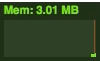

# vue3-memorystats

[](https://www.npmjs.com/package/vue3-memorystats)
[](https://github.com/rohilv/vue3-memorystats/actions/workflows/ci.yml)
[](LICENSE)

**vue3-memorystats** adds a live memory usage graph to your Vue 3 app with one line: `app.use(vMemoryStats)`.
It is a Vue 3 plugin based on [Paul Irish's memory-stats](https://github.com/paulirish/memory-stats.js).

It works in Chrome only, and shows precise numbers when Chrome is started with `--enable-precise-memory-info` (see below).



## Installation

```
npm install vue3-memorystats
```

## Usage

```
// main.js
import { createApp } from 'vue'
import App from './App.vue'
import vMemoryStats from 'vue3-memorystats'

const app = createApp(App)
app.use(vMemoryStats)
app.mount('#app')
```

## Start Chrome with --enable-precise-memory-info

```
# Linux
google-chrome --enable-precise-memory-info --enable-memory-info

#MacOS
/Applications/Google\ Chrome.app/Contents/MacOS/Google\ Chrome --enable-precise-memory-info --enable-memory-info
or
open -a 'Google Chrome' --args --enable-precise-memory-info --enable-memory-info
```

## Development

```
// install dependencies
npm install
// run example locally and start server
npm run dev
```
